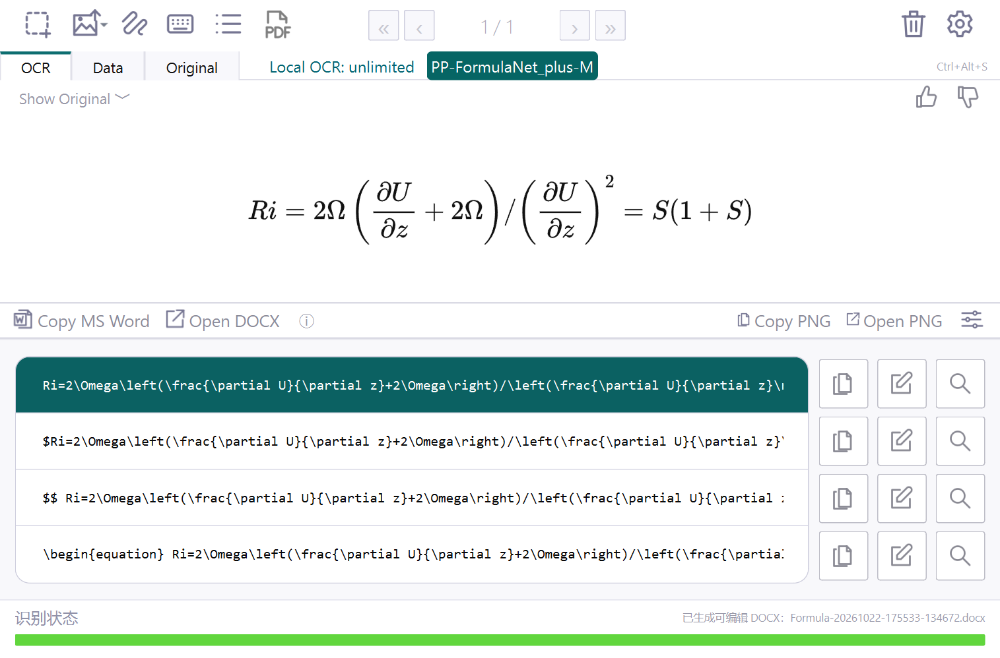

# MixSnip

Windows 本地公式识别桌面软件：快捷键截图、公式预览、复制 LaTeX、Word/PPT 可编辑公式，全程离线。

Fork 自 [RQLuo/MixTeX-Latex-OCR](https://github.com/RQLuo/MixTeX-Latex-OCR)。MixSnip 位于 [`desktop/`](desktop/)，上游说明保存在 [README.upstream.md](README.upstream.md)，上游代码和提交历史保留。本项目与 Mathpix 无关联，使用独立名称和图标。

## 下载

在 [Releases](https://github.com/Circular-E/MixSnip/releases/latest) 下载 `MixSnip-0.3.0-windows-x64-portable.zip`，**完整解压**到有写入权限的目录，运行 `MixSnip.exe`。不要在压缩包内运行，也不要单独移动 exe。

支持 Windows 10/11 x64，无需另装 Python、GPU、LaTeX 或 API Key。包内已含模型和运行库；可用发布页的 `SHA256SUMS.txt` 校验下载文件。

- 全局快捷键截图，默认 Ctrl+Alt+M；占用时尝试 Ctrl+Shift+M / Ctrl+Alt+S。
- 黑底公式直接截图，内部自动处理识别副本；Original 页和历史保留原始颜色。
- OCR / Data / Original 页面、公式预览、LaTeX 编辑与复制、历史查询。
- **Copy MS Word**：Word/PPT 中粘贴为可编辑公式；**Open DOCX**：导出原生 OMML 文档。
- PNG 导出、系统托盘、可选开机自启动、识别取消与超时。
- 默认 PP-FormulaNet_plus-M，可在设置中切回 MixTeX v3.2.4。



界面图使用手动输入公式展示排版，不代表该图经过 OCR 识别。

## 识别效果与限制

一次小样本验证使用 8 张印刷公式截图、4 类不同公式。统一白底预处理，CPU 4 线程，每图重复 2 次，统计第 2 次耗时：

| 模型 | 严格整式正确（含标点） | 公式本体正确 | 热运行中位数 |
|---|---:|---:|---:|
| MixTeX | 2/8 | 2/8 | 0.95 秒 |
| PP-FormulaNet_plus-M | 7/8 | 8/8 | 3.26 秒 |
| PP-FormulaNet_plus-L | 7/8 | 8/8 | 6.54 秒 |

测试机器为 i9-13900HX，PaddleOCR 3.3.2 / PaddlePaddle 3.2.2，MKL-DNN 关闭。M/L 都在同一张图末尾多生成逗号，因此选择准确率相同、速度更快的 M。首次加载约 17～21 秒，之后复用模型。实际速度取决于机器和图片。

这是存在重复截图的个人小样本测试，不是通用准确率，也不是与 Mathpix 的对比。个人历史和原图不随公开包分发。复杂手写、模糊图和长公式可能错误，请核对关键符号与标点。FormulaNet 以公式为主，纯文字可切换 MixTeX。PDF 全文转换尚未实现，绿色条只表示任务状态。

## 开发

参见 [开发与打包说明](desktop/BUILD.md)。桌面基于 Python 3.12 / PySide6，Paddle 在独立本地子进程中运行。

```text
desktop/source/      应用、OCR 适配器、Office 导出、测试与构建配置
desktop/licenses/    上游及依赖许可、模型来源和校验值
desktop/models/      默认配置（Git 中不提交权重）
desktop/scripts/     清洁打包脚本
```

运行时在软件目录的 `data/` 创建截图、历史与设置；发布包不含个人 data。没有云端识别、账号、遥测或自动更新。

## 授权与署名

MixTeX 作者为 Renqing Luo / RQLuo，保留 [AGPL-3.0](LICENSE) 与[上游用户协议](desktop/licenses/MixTeX-upstream-terms.md)。**上游另声明基于 MixTeX 模型的衍生品不得用于商业用途**；本包包含该模型，请遵守其条款。MixSnip 应用衍生代码采用 AGPL-3.0，完整对应源码随仓库与发布包提供。

PP-FormulaNet / PaddleOCR 来自 PaddlePaddle 团队，使用 Apache-2.0；采用官方未修改推理权重。PySide6/Qt、MathJax、ONNX Runtime、Paddle、CPython 等许可见 [`desktop/licenses/`](desktop/licenses/) 及运行库。Office 转换使用电脑上已有的 Office XSL 或开源转换器，不分发微软 XSL。

本项目不代表 MixTeX、PaddlePaddle、Microsoft 或 Mathpix 官方产品。
